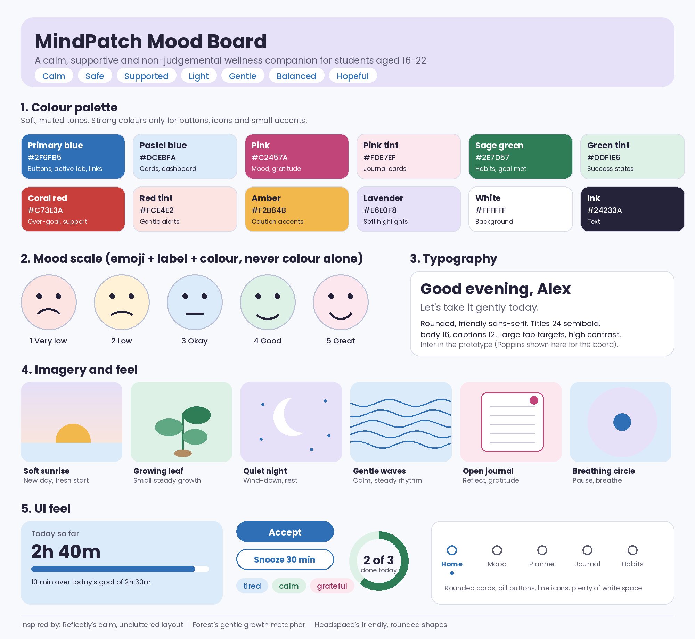
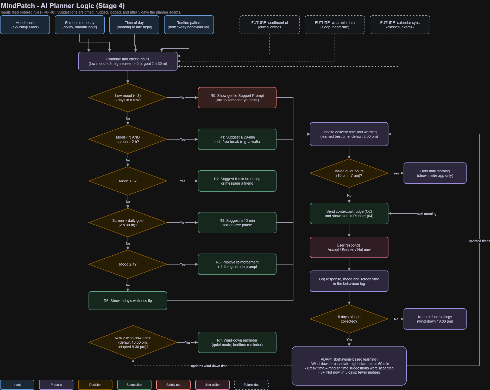

# MindPatch: AI-Assisted Digital Detox and Wellness Planner

**From Empathy to Execution: Designing User-Centered AI Digital Solutions Prototype**
Critical and Creative Thinking, Summative Assessment, Scenario 2 (MindPatch Wellness Labs)

Sri Prasath.P | Registration No. 1000408 | CRS: Artificial Intelligence | Course: Critical and Creative Thinking | Jain Vidyalaya IB World School

---

## 1. Project overview and purpose

Students study, socialise and relax on the same few devices, so the line between "on" and "off" disappears. Research links heavy, late-night and problematic phone use with stress, poorer sleep and lower wellbeing, although the evidence is mixed.

**MindPatch** is a calm, AI-assisted wellness planner for students aged roughly 16 to 22. It lets students log their mood, see their screen time, and get **transparent, personalised detox suggestions**, then builds small healthy routines through gentle nudges, goals and forgiving rewards.

**What this repository contains:** the full design process from research to a clickable Figma prototype, a simulated AI planner (flowchart and 5-day behaviour log), user testing with a Google Form, and an ethical reflection. MindPatch is a **design prototype**. The AI logic is simulated and all data is sample data, not real users.

## 2. Project links

| What | Link |
|---|---|
| Clickable Figma prototype | [Open the prototype](https://www.figma.com/make/JxtQFwInNt4TA1MPSgMFbI/High-Fidelity-Mobile-Prototype?t=DiSTaB9TQrAGcfqE-20&fullscreen=1) |
| Figma design frames | [Open the Figma file](https://www.figma.com/design/DZFEEIXki2uhbeYPg5d7AX/Untitled?node-id=0-1&m=dev&t=xhPhKSdgVh3yQzLk-1) |
| AI logic flowchart | [Open in draw.io viewer](https://viewer.diagrams.net/?tags=%7B%7D&lightbox=1&highlight=0000ff&edit=_blank&layers=1&nav=1&title=MindPatch_AI_Logic_Flowchart.drawio&dark=auto#Uhttps%3A%2F%2Fdrive.google.com%2Fuc%3Fid%3D1OEUcUbPAVs9EQ3dWoj0RzBLtOyBgLJ_u%26export%3Ddownload) |
| User feedback form | [Open the Google Form](https://forms.gle/vY3VhTx1r3B4qkH67) |
| Feedback responses | [Open the response sheet](https://docs.google.com/spreadsheets/d/1x-_lV_qAmn0XGUtw2HfWzKjCpVCc9YDla4BG4S1QDmM/edit?usp=sharing) |

## 3. Design process at a glance

| Stage | What I did | Evidence |
|---|---|---|
| 1. Empathize and define | Secondary research (8 studies), review of Headspace, Forest and Reflectly, behaviour-change theory, 2 personas, 2 empathy maps, mood board, problem statement and how-might-we questions | [docs/step1-research.md](docs/step1-research.md) |
| 2. Ideate and sketch | SCAMPER and mind mapping, then low-fidelity wireframes and screen flow | [Figma design frames](https://www.figma.com/design/DZFEEIXki2uhbeYPg5d7AX/Untitled?node-id=0-1&m=dev&t=xhPhKSdgVh3yQzLk-1) |
| 3. Prototype | 8 high-fidelity screens and 6 overlays, fully clickable | [Figma prototype](https://www.figma.com/make/JxtQFwInNt4TA1MPSgMFbI/High-Fidelity-Mobile-Prototype?t=DiSTaB9TQrAGcfqE-20&fullscreen=1) |
| 4. AI logic simulation | Rule-based planner flowchart and a 5-day behaviour simulation | [Section 7](#7-ai-logic) and [files/behaviour-log-simulation.xlsx](files/behaviour-log-simulation.xlsx) |
| 5. Test and reflect | 4 peers, 5-question Google Form, 2 design iterations, ethical reflection | [Sections 8 and 9](#8-user-testing-and-iterations) |

## 4. Key features and app flow

### The five compulsory features

| Feature | How it works in MindPatch |
|---|---|
| **Mood Logging** | A 5-level emoji slider that changes colour and label, plus optional tags and a note |
| **Screen-Time Dashboard** | Manual hours and minutes, a 7-day bar chart with a goal line, top apps, and a mood and screen-time insight |
| **AI-Generated Detox Planner** | Suggests a break from mood, screen time, time of day and routine, and shows **why** (the inputs and the rule used) |
| **Gratitude Journal** | Three soft prompts and a colour picker, so entries are colour-coded and visual |
| **Habit Tracker with Rewards** | Streaks, badges and goal-setting, with forgiving streaks that pause instead of resetting |

### Additional features, each added for a reason

| Feature | Why it exists |
|---|---|
| **5-Minute Breathing Break** | Gives the planner's nudge an immediate one-tap action. Two of four testers said a short guided exercise would help most on a stressful day. |
| **Settings and Privacy** | Lets users control notifications, quiet hours, text size and motion, and states how data is handled. Two of four testers asked for these settings. |
| **Wind-Down Mode** | Late-night use was the riskiest period in the research, so evenings get their own quiet routine. |
| **Mood and Screen-Time Insight** | Builds the self-awareness the research recommends and makes the AI logic visible. |
| **Support Prompt** | A gentle "talk to someone you trust" message after repeated low moods. This is an ethical safety net, not a diagnosis. |
| **Daily Wellness Tips** | Short, low-pressure ideas. The brief lists this as a core screen. |
| **Simulated notifications** | Nudge banners such as "Take a tech-free walk?" and "5-minute breathing break", as the brief describes. |

### App flow

| Path | Flow |
|---|---|
| Main path | Home → Mood Logger → Mood Saved → Detox Planner → Accept → Habits → Home |
| From the dashboard | Home → Screen Time → Detox Planner |
| From a nudge | Home → Nudge Banner → Detox Planner |
| Breathing break | Detox Planner → 5-min breathing → Breathing Break → Breathing Complete → Habits |
| Settings | Home → profile icon → Settings and Privacy |
| Support | Mood Logger → Need support? → Support Prompt |

**Screens (8):** Home, Mood Logger, Screen Time, Detox Planner, Gratitude Journal, Habits, Daily Tips, Breathing Break.
**Overlays and states (6):** Mood Saved, Nudge Banner, Support Prompt, Settings and Privacy, Breathing Complete, Set Goals.

### Design choices

- **Colour psychology:** blue and lavender for calm, pink for warmth (mood and gratitude), sage green for growth and goals met, amber for caution, and coral red only for gentle alerts. See the [mood board](images/mood-board.png).
- **Accessibility:** the palette was checked for at least 4.5:1 text contrast. Every status uses an icon or a label as well as colour, mood uses an emoji plus a label, and screens are designed for large tap targets and low cognitive load.
- **Tone:** no guilt, shame or leaderboards. Streaks pause instead of resetting.



## 5. Research findings and references

Full details, personas, empathy maps and the complete reference list are in [docs/step1-research.md](docs/step1-research.md). The main findings that shaped the design:

1. **Timing matters as much as total hours.** Evening and late-night use stands out across studies, so the planner takes time of day as an input and has a wind-down mode.
2. **Hours alone are a weak signal.** One 12-week study found no week-to-week link between phone use and mood, so the planner reads mood, timing and routine together.
3. **Self-awareness comes first.** Researchers recommend building awareness before regulation, which justifies the mood log and dashboard.
4. **Support and balance beat bans.** Heavy but non-problematic users reported stronger peer support, so MindPatch promotes balance, not abstinence.
5. **Make it tiny and forgiving.** Behaviour science (Fogg, nudge theory, habit loops) says easy actions and well-timed prompts work better than willpower.

**Key references**

- Alkaabba, A., et al. (2025). The digital dilemma: Patterns of screen time, sleep quality, and mental health among Saudi university students. *Cureus, 17*(9), e91882. https://doi.org/10.7759/cureus.91882
- Kaewpradit, K., Ngamchaliew, P., & Buathong, N. (2025). Digital screen time usage, prevalence of excessive digital screen time, and its association with mental health, sleep quality, and academic performance among Southern University students. *Frontiers in Psychiatry, 16*, 1535631. https://doi.org/10.3389/fpsyt.2025.1535631
- Bradley, A. H., & Howard, A. L. (2023). Stress and mood associations with smartphone use in university students: A 12-week longitudinal study. *Clinical Psychological Science, 11*(5), 921-941. https://doi.org/10.1177/21677026221116889
- Rajput, L., et al. (2026). Screen time and its impact on university students. *Biomedicinska istrazivanja, 17*(1), 1-10. https://biomedicinskaistrazivanja.mef.ues.rs.ba/article/618
- Boniel-Nissim, M., et al. (2024). *A focus on adolescent social media use and gaming in Europe, central Asia and Canada: HBSC international report, Volume 6.* WHO Regional Office for Europe. https://www.who.int/europe/publications/i/item/9789289061322
- Thaler, R. H., & Sunstein, C. R. (2008). *Nudge.* Yale University Press.
- Fogg, B. J. (2019). *Tiny Habits.* Fogg Behavior Model: https://www.behaviormodel.org/
- Duhigg, C. (2012). *The Power of Habit.* Random House.

## 6. Screenshots of the prototype

All screenshots of the prototype are in the **[screenshots folder](screenshots/)**. This includes the screens, the before and after images for the design iterations, and the Google Form response summary. Click the link to open the folder.

You can also try the live version: [clickable Figma prototype](https://www.figma.com/make/JxtQFwInNt4TA1MPSgMFbI/High-Fidelity-Mobile-Prototype?t=DiSTaB9TQrAGcfqE-20&fullscreen=1).

## 7. AI logic

MindPatch does not run a live AI model. The planner is a **rule-based system, simulated** in a flowchart and a spreadsheet, that shows how an adaptive planner would behave.



**Inputs:** mood score (1-5), screen time today (hours), time of day, and routine pattern (learned from the last 5 days).

**Rules** (checked in order; R4 runs on the clock):

| Code | Condition | Suggestion |
|---|---|---|
| R0 | Mood below 3 for 3 days in a row | Support Prompt: talk to someone you trust |
| R1 | Mood < 3 **and** screen time > 2 h | 20-minute tech-free break (the brief's example rule) |
| R2 | Mood < 3 and screen time <= 2 h | 5-minute breathing or message a friend |
| R3 | Mood >= 3 and screen time > daily goal (2 h 30 m) | 10-minute screen-free pause |
| R4 | Clock reaches wind-down time | Wind-down reminder (quiet mode, bedtime reminder) |
| R5 | Mood >= 4 and screen time <= goal | Praise and a one-line gratitude prompt |
| R6 | None of the above | Daily wellness tip |

Only R1 comes straight from the brief. The other thresholds are my design decisions and can be changed in the Settings tab of the spreadsheet.

**Adaptation after 5 days.** The simulation ([files/behaviour-log-simulation.xlsx](files/behaviour-log-simulation.xlsx), import it into Google Sheets) logs five days of sample behaviour and applies formulas:

| Day | Mood | Screen time | Rule fired | Suggested at | Response |
|---|---|---|---|---|---|
| Sat | 2 | 3.8 h | R1 | 9:00 pm | Not now |
| Sun | 2 | 4.1 h | R1 | 8:00 pm | Snoozed |
| Mon | 3 | 2.9 h | R3 | 7:30 pm | Accepted |
| Tue | 2 | 3.4 h | R1 | 7:00 pm | Not now |
| Wed | 4 | 2.5 h | R5 | 7:30 pm | Accepted |

| Setting | Before | After | How |
|---|---|---|---|
| Wind-down time | 10:30 pm | **9:30 pm** | Usual late-night start (10:30 pm) minus 60 minutes |
| Break suggestion time | 8:00 pm | **7:30 pm** | Median time suggestions were accepted |
| Nudge frequency | Medium | Medium | Only 2 "Not now" responses, below the threshold of 3 |
| Support Prompt | Off | Not triggered | Longest low-mood run was 2 days |

On day 6 (today in the prototype) mood is 2 and screen time is 2 h 40 m, so R1 fires and the Planner suggests a 20-minute walk at 7:30 pm, matching the Detox Planner screen.

**Contextual nudges:** a tech-free walk after 2 hours on screen, a wind-down reminder at the adapted time, a streak reminder, a one-tap breathing break on busy days, and a gratitude prompt after a good day. Nudges respect quiet hours (10 pm to 7 am) and the user's frequency setting.

**Limits.** Five days is a tiny sample, the accepted time rests on two responses, and all data is simulated. A real system would need more data, consent and a way to reset what it has learned.

## 8. User testing and iterations

### Method
Four peers tried the clickable prototype and answered a five-question multiple-choice [Google Form](https://forms.gle/vY3VhTx1r3B4qkH67) ([responses](https://docs.google.com/spreadsheets/d/1x-_lV_qAmn0XGUtw2HfWzKjCpVCc9YDla4BG4S1QDmM/edit?usp=sharing)).

The response summary screenshot is in the [screenshots folder](screenshots/).

### Results (4 responses)

| Question | Answers |
|---|---|
| 1. How easy was it to move around? | Very easy: 3, Easy: 1 |
| 2. Most useful part | Habit Tracker, Detox Planner, Daily Tips, Screen-time dashboard (1 each) |
| 3. What helps on a stressful day | A short guided exercise: 2, Tracking habits and streaks: 2 |
| 4. Biggest worry | Nothing: 3, Who can see my mood and journal entries: 1 |
| 5. Most comfortable change | Settings for notifications, privacy and text size: 2, More tips: 1, Already comfortable: 1 |

All four found the prototype easy or very easy to use, and each tester picked a different feature as the most useful, so no feature was removed.

### Design iterations

| | Iteration 1: 5-Minute Breathing Break | Iteration 2: Settings and Privacy |
|---|---|---|
| **Feedback** | 2 of 4 said a short guided exercise helps most on a stressful day | 2 of 4 asked for settings for notifications, privacy and text size, and 1 worried about who can see mood and journal entries |
| **Before** | The planner could suggest a break, but there was no guided exercise to start from the app | There was no way to control nudges or text size, and no statement of how data is handled |
| **After** | A breathing screen with an animated circle, a timer and a completion pop-up, reachable from the planner and the nudge banner. It also ticks the breathing habit. | A settings sheet with notifications, quiet hours, nudge frequency, wind-down mode, text size, reduce motion, a privacy statement and a delete-data option |
| **What improved** | Users can act on a suggestion immediately with one tap | Users control their nudges and reading comfort, and privacy is visible |

Before and after screenshots for both iterations are in the [screenshots folder](screenshots/).

**Limits of the testing.** Four peers is a small, friendly sample, so these results show direction and are not proof. The form measures opinions, not behaviour over time.

## 9. Ethical reflection

**Fairness.** The same rules apply to every user, and they are shown openly through "Why this suggestion?". There are no leaderboards, rankings or streak penalties, and streaks pause instead of resetting so people with irregular days are not punished. The thresholds (for example 2 hours) are design defaults, not medical standards, and my research mostly covers university students and adolescents in particular countries, so the defaults may not fit everyone. Users can change their goals.

**Accessibility.** The palette was checked for text contrast, status is never shown by colour alone (important for red-green colour blindness), mood uses an emoji and a label, and the design uses large tap targets and simple screens. Settings include text size and reduce motion. This was not tested with screen readers or with users who have disabilities, which is a limitation.

**Data privacy.** Mood and journal entries are sensitive. The design collects as little as possible: screen time is entered manually, nothing is shared, data is private by default, and users can delete it. Notifications are opt-in with quiet hours. This prototype uses only sample data. The feedback form was used only for this project, and this repository shows the summary of results, not individual names.

**Responsible AI.** The planner explains every suggestion, the user always decides ("MindPatch suggests. You decide."), and it never labels or diagnoses anyone. Repeated low mood only triggers a gentle message about talking to someone you trust, with no phone numbers because they differ by country. MindPatch is a wellbeing helper, not a medical service, and it should not replace human support.

## 10. Project impact and user benefits

**For students**
- See how mood and screen habits connect, without being judged
- Get breaks that fit their mood, schedule and time of day, with the reason shown
- Start healthy routines in tiny steps that still work on low-energy days
- Stay in control of nudges, privacy and reading comfort

**For the wider goal**
- It supports the self-awareness and balanced use that the research recommends, instead of blocking or shaming
- It shows how a transparent, rule-based AI can personalise support while keeping the user in charge

**Honest note:** these are intended benefits of a design prototype. Impact has not been measured. A real study would track sleep, mood and screen-time habits over weeks with consenting users.

## 11. Future work

| Idea | What it would add |
|---|---|
| Sentiment analysis of journal entries | Notice rising stress before the user logs a low mood (on-device and opt-in) |
| Wearable data (sleep, heart rate) | Replace guesses with real sleep and stress signals to tune the wind-down time |
| Calendar sync | Avoid nudges during classes and exams and suggest breaks in free slots |
| Automatic screen-time sync | Remove manual entry and improve accuracy |
| A real learning model | Replace fixed rules once enough consented data exists |

## 12. Repository structure

```
README.md                       Project overview (this file)
docs/step1-research.md          Research, apps, personas, empathy maps, mood board, define, references
images/
  mood-board.png
  ai-logic-flowchart.png
screenshots/                    Prototype screenshots (screens, before and after, form summary)
files/behaviour-log-simulation.xlsx   5-day behaviour simulation (import into Google Sheets)
```

## 13. Author

Sri Prasath.P, Registration No. 1000408, CRS: Artificial Intelligence, Jain Vidyalaya IB World School.
